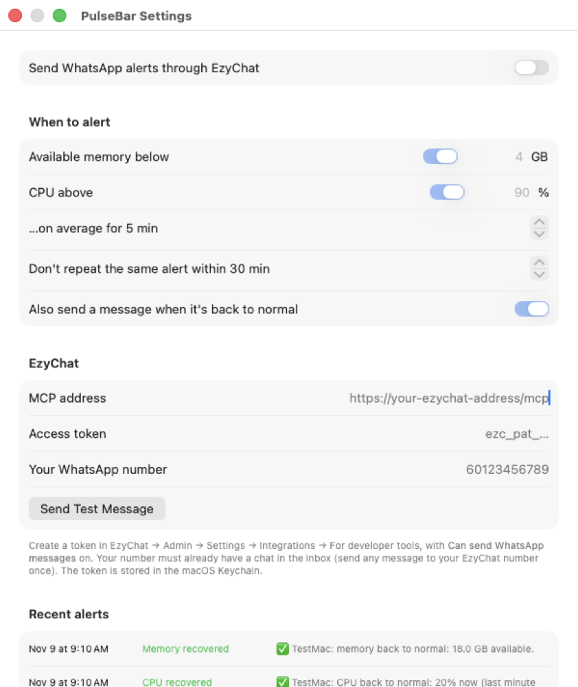

# PulseBar

A tiny macOS menu-bar app and floating desktop widget that shows **available memory** and **CPU
utilization**, records **30 days of history**, and can send **WhatsApp alerts through
[EzyChat](https://github.com/ossmalaysia/ezychat-lite)'s MCP server** when your Mac runs low on memory
or stays busy for too long.

Native Swift/AppKit + SwiftUI Charts, three source files, no dependencies, no Xcode project.

<p>
  
  
</p>

## Features

- **Menu bar**: available memory and CPU %, e.g. `21.5 GB · 10%`. Turns red when memory is low or CPU is pegged.
- **Floating widget**: two cards (memory, CPU) that stay on top on every Space. Drag to move.
  Click a card to open its history. Right-click opens the menu.
- **History**: one sample per minute (average and peak), kept for 30 days. Charts for 24 hours, 7 days and 30 days,
  with average and peak values, time above 80% CPU, and so on.
- **Alerts over WhatsApp (optional)**: when available memory stays below *X GB* or CPU stays above *Y %*
  for *N* minutes. Includes the top processes, a cooldown, and a "back to normal" message.

Memory is computed the way Activity Monitor does: *used = app memory + wired + compressed*, so
*available = total − used*. CPU % is the change in host CPU ticks across all cores.

## Requirements

- macOS 14 (Sonoma) or later
- Xcode Command Line Tools (`xcode-select --install`) for `swiftc`

## Build and run

```sh
git clone https://github.com/ossmalaysia/pulsebar.git
cd pulsebar
./build.sh            # builds PulseBar.app here
open PulseBar.app
./build.sh --install  # optional: copies to /Applications
```

To start it at login, add PulseBar under **System Settings → General → Login Items**.

## Using it

| Do this | To |
|---|---|
| Click the menu-bar item | Show/hide widget, Memory History (⌘H), CPU History (⌘J), **Settings… (⌘,)**, Record History, Quit |
| Right-click the widget | Open the same menu |
| Click a card | Open that card's history |
| Drag a card | Move the widget (the position is remembered) |

## WhatsApp alerts via EzyChat

PulseBar calls EzyChat's built-in MCP server (`/mcp`) directly. It sends a single JSON-RPC
`tools/call` request to `send_message` with a personal access token. Claude or any other AI client
doesn't need to be running.

1. In EzyChat, go to **Admin → Settings → Integrations → For developer tools** and create an access token
   with **Can send WhatsApp messages** turned on.
2. From your phone, message your EzyChat WhatsApp number once, so that your number has a chat in the inbox.
3. In PulseBar, open **Settings…** and enter the MCP address (`https://<your-ezychat>/mcp`), the token and your
   number with country code. Then click **Send Test Message**.
4. Set the thresholds and turn on **Send WhatsApp alerts through EzyChat**.



How alerts behave:

- They trigger on the **average over the window** (default 5 min), not on single spikes.
- One alert per condition, then a **cooldown** (default 30 min).
- "Back to normal" is only sent after an alert was actually delivered, and only once the value is clearly
  past the limit (memory ≥ limit + 1 GB, CPU ≤ limit − 10 points), so a value sitting near the line doesn't flap.
- If sending fails (bad token, server unreachable), PulseBar retries after 5 min. Every attempt is shown
  under **Recent alerts**.

## Privacy

- History and the alert log stay on your Mac in `~/Library/Application Support/PulseBar/`
  (`history.csv`, `alerts.log`).
- The EzyChat token is stored in the **macOS Keychain**, not in preferences or files.
- The only thing sent anywhere is the alert text, which goes to your own EzyChat server. It includes the
  computer name and the names of the top 3 processes.

## Development

```
main.swift      app delegate, menu bar, floating widget, memory/CPU sampling
history.swift   per-minute recorder, CSV store, history window (Swift Charts)
alerts.swift    alert engine, EzyChat MCP client, Keychain, settings window
build.sh        swiftc build + .app bundle (ad-hoc signed)
```

Self-tests (no Accessibility permission needed):

```sh
# Widget drag vs click handling
./PulseBar.app/Contents/MacOS/PulseBar --selftest

# Alert engine: simulates ~40 minutes of samples against a mock EzyChat MCP server
python3 scripts/mock_ezychat_mcp.py 8765 /tmp/sent.jsonl &
PULSEBAR_HISTORY=/tmp/pb-history.csv PULSEBAR_MCP_URL=http://127.0.0.1:8765/mcp \
PULSEBAR_TOKEN=ezc_pat_testtoken123 ./PulseBar.app/Contents/MacOS/PulseBar --alerttest
```

`PULSEBAR_HISTORY` redirects the data files, so tests don't touch your real history.
`--show-history` and `--show-settings` open those windows at launch.

## License

[MIT](LICENSE)
