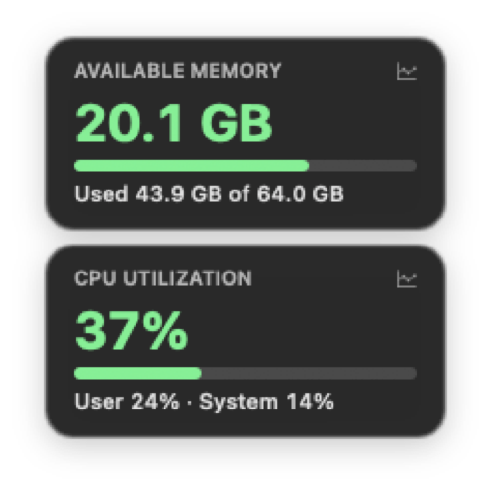
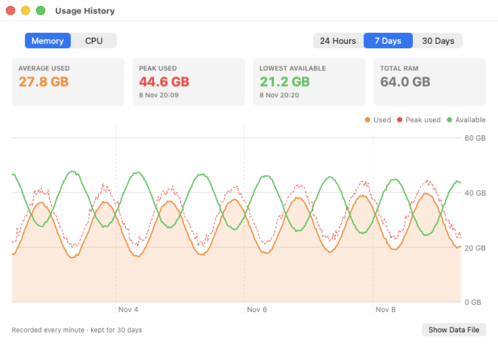
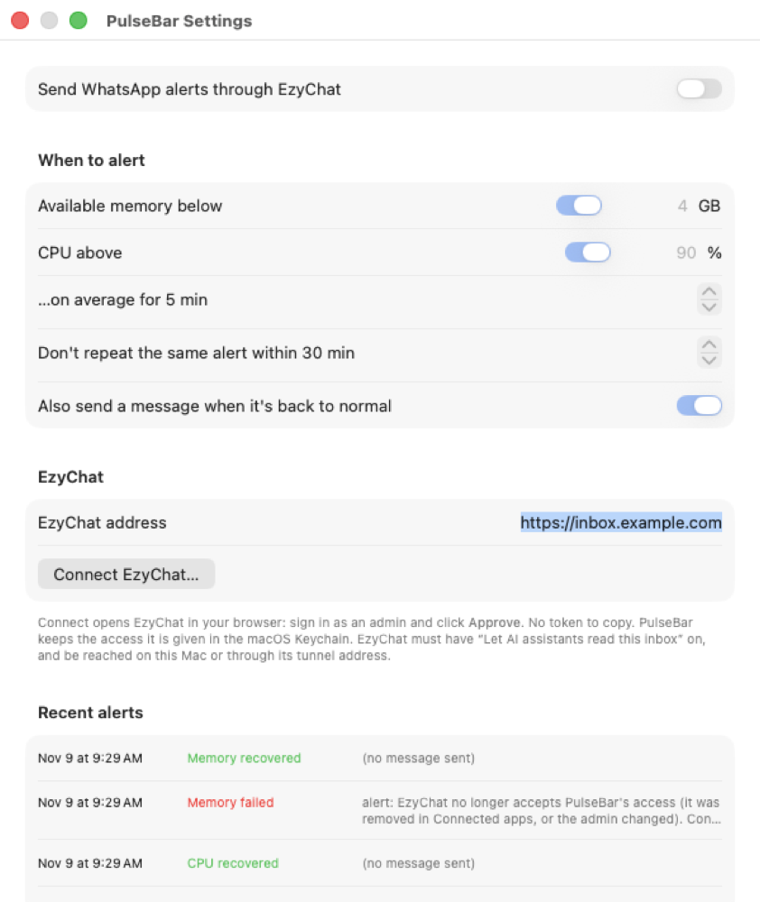
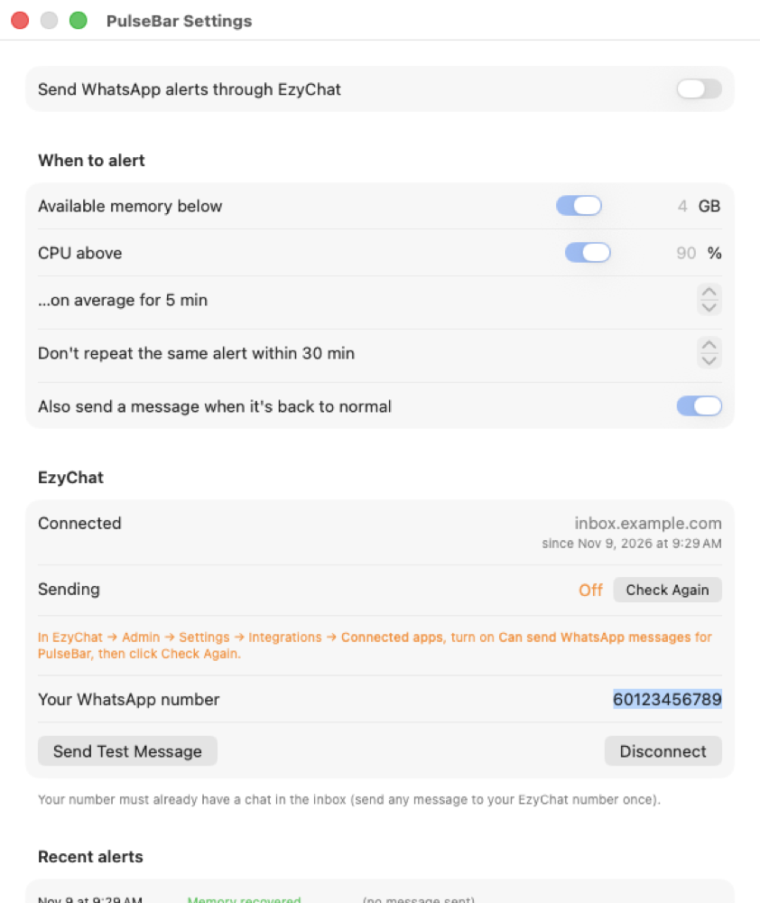

# PulseBar

A tiny macOS menu-bar app and floating desktop widget that shows **available memory** and **CPU
utilization**, records **30 days of history**, and can send **WhatsApp alerts through
[EzyChat](https://github.com/ossmalaysia/ezychat-lite)'s MCP server** when your Mac runs low on memory
or stays busy for too long.

Native Swift/AppKit + SwiftUI Charts, three source files, no dependencies, no Xcode project.

<p>
  
  
</p>

## Features

- **Menu bar**: available memory and CPU %, e.g. `21.5 GB · 10%`. Turns red when memory is low or CPU is pegged.
- **Floating widget**: two cards (memory, CPU) that stay on top on every Space. Drag to move.
  Click a card to open its history. Right-click opens the menu.
- **History**: one sample per minute (average and peak), kept for 30 days. Charts for 24 hours, 7 days and 30 days,
  with average and peak values, time above 80% CPU, and so on.
- **Alerts over WhatsApp (optional)**: when available memory stays below *X GB* or CPU stays above *Y %*
  for *N* minutes. Includes the top processes, a cooldown, and a "back to normal" message.

Memory is computed the way Activity Monitor does: *used = app memory + wired + compressed*, so
*available = total − used*. CPU % is the change in host CPU ticks across all cores.

## Requirements

- macOS 14 (Sonoma) or later
- Xcode Command Line Tools (`xcode-select --install`) for `swiftc`

## Build and run

```sh
git clone https://github.com/ossmalaysia/pulsebar.git
cd pulsebar
./build.sh            # builds PulseBar.app here
open PulseBar.app
./build.sh --install  # optional: copies to /Applications
```

To start it at login, add PulseBar under **System Settings → General → Login Items**.

## Using it

| Do this | To |
|---|---|
| Click the menu-bar item | Show/hide widget, Memory History (⌘H), CPU History (⌘J), **Settings… (⌘,)**, Record History, Quit |
| Right-click the widget | Open the same menu |
| Click a card | Open that card's history |
| Drag a card | Move the widget (the position is remembered) |

## WhatsApp alerts via EzyChat

PulseBar signs in to EzyChat's built-in MCP server (`/mcp`) with **OAuth**, the same way claude.ai
connects to it. You never copy a token. After that, PulseBar sends each alert with one JSON-RPC
`tools/call` request to `send_message`. Claude or any other AI client doesn't need to be running.

1. In EzyChat, go to **Admin → Settings → Integrations** and turn on **Let AI assistants read this inbox**.
2. From your phone, message your EzyChat WhatsApp number once, so that your number has a chat in the inbox.
3. In PulseBar, open **Settings…**, enter your EzyChat address (e.g. `https://<your-ezychat>`, or
   `localhost:<port>` when EzyChat runs on the same Mac), and click **Connect EzyChat…**.
4. Your browser opens EzyChat. Sign in as an admin and click **Approve**.
5. New apps can't send by default. In EzyChat → **Connected apps**, turn on **Can send WhatsApp messages**
   for PulseBar. Then click **Check Again** in PulseBar, enter your number and click **Send Test Message**.
   If your EzyChat has more than one WhatsApp number (inbox), choose the one alerts come from under **Send from**.
6. Set the thresholds and turn on **Send WhatsApp alerts through EzyChat**.

<p>
  
  
</p>

How the sign-in works (the [MCP authorization](https://modelcontextprotocol.io/specification/draft/basic/authorization) flow):

- **Discovery**: `/.well-known/oauth-protected-resource/mcp` points to the authorization server metadata.
- **Registration**: PulseBar registers itself as a public client (RFC 7591). It has no client secret.
- **Approval**: the browser opens the approval page with **PKCE S256**. EzyChat sends the browser back to a
  one-time loopback address, `http://127.0.0.1:<random port>/callback` (RFC 8252). PulseBar listens there
  only during sign-in.
- **Token**: the one-time code and PKCE verifier are exchanged for an app token, which is stored in the
  **macOS Keychain**. EzyChat issues no refresh token. Access lasts until you remove PulseBar under
  **Connected apps**, or click **Disconnect** in PulseBar. If EzyChat stops accepting the token,
  PulseBar shows "Connect" again.
- EzyChat accepts sign-in only on the same computer or through its tunnel address.

How alerts behave:

- They trigger on the **average over the window** (default 5 min), not on single spikes.
- One alert per condition, then a **cooldown** (default 30 min).
- "Back to normal" is only sent after an alert was actually delivered, and only once the value is clearly
  past the limit (memory ≥ limit + 1 GB, CPU ≤ limit − 10 points), so a value sitting near the line doesn't flap.
- If sending fails (bad token, server unreachable), PulseBar retries after 5 min. Every attempt is shown
  under **Recent alerts**.

## Privacy

- History and the alert log stay on your Mac in `~/Library/Application Support/PulseBar/`
  (`history.csv`, `alerts.log`).
- The EzyChat access from OAuth sign-in is stored in the **macOS Keychain**, not in preferences or files.
- The only thing sent anywhere is the alert text, which goes to your own EzyChat server. It includes the
  computer name and the names of the top 3 processes.

## Development

```
main.swift      app delegate, menu bar, floating widget, memory/CPU sampling
history.swift   per-minute recorder, CSV store, history window (Swift Charts)
alerts.swift    alert engine, EzyChat MCP client, Keychain, settings window
oauth.swift     EzyChat OAuth sign-in: discovery, client registration, PKCE, loopback redirect
build.sh        swiftc build + .app bundle (ad-hoc signed)
```

Self-tests (no Accessibility permission needed):

```sh
# Widget drag vs click handling
./PulseBar.app/Contents/MacOS/PulseBar --selftest

# Alert engine: simulates ~40 minutes of samples against a mock EzyChat MCP server
python3 scripts/mock_ezychat_mcp.py 8765 /tmp/sent.jsonl &
PULSEBAR_HISTORY=/tmp/pb-history.csv PULSEBAR_MCP_URL=http://127.0.0.1:8765/mcp \
PULSEBAR_TOKEN=ezc_pat_testtoken123 ./PulseBar.app/Contents/MacOS/PulseBar --alerttest

# OAuth sign-in end to end (the authorize page is fetched headlessly instead of opening a browser)
python3 scripts/mock_ezychat_mcp.py 8770 /tmp/sent.jsonl --grant-send &   # also try --deny, --mcp-off, --inboxes
PULSEBAR_TOKEN=unused PULSEBAR_EZYCHAT_ADDRESS=127.0.0.1:8770 ./PulseBar.app/Contents/MacOS/PulseBar --oauthtest
```

`PULSEBAR_TOKEN` puts the app in test mode: it never reads or writes the real Keychain or EzyChat settings.
`PULSEBAR_HISTORY` redirects the data files, so tests don't touch your real history.
`--show-history` and `--show-settings` open those windows at launch.

## License

[MIT](LICENSE)
